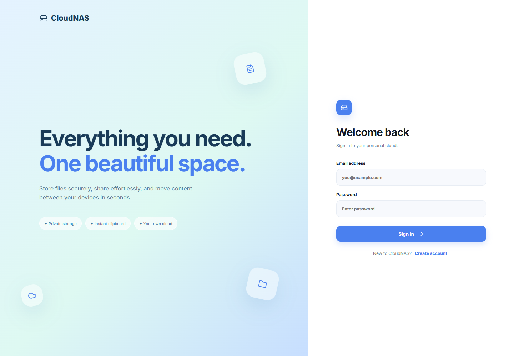
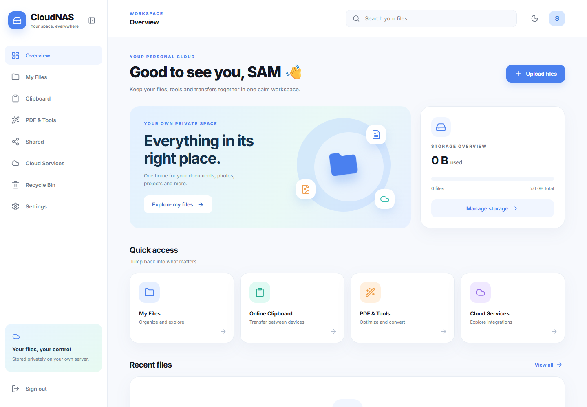
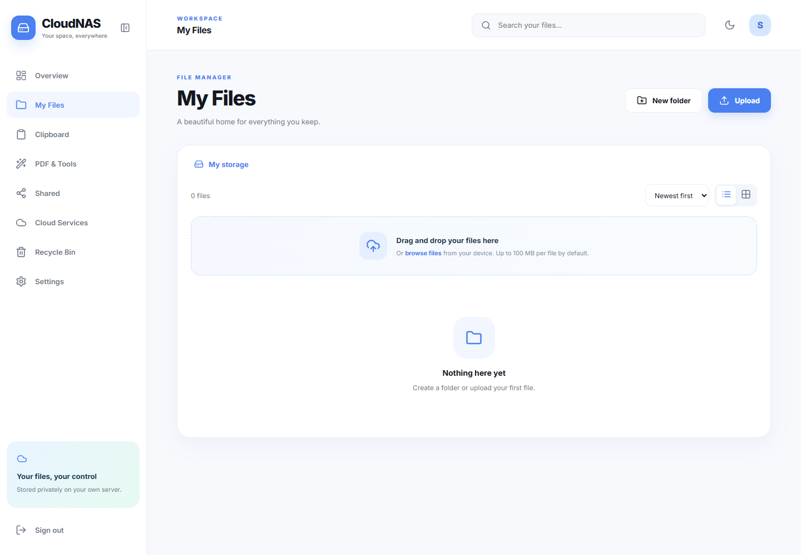
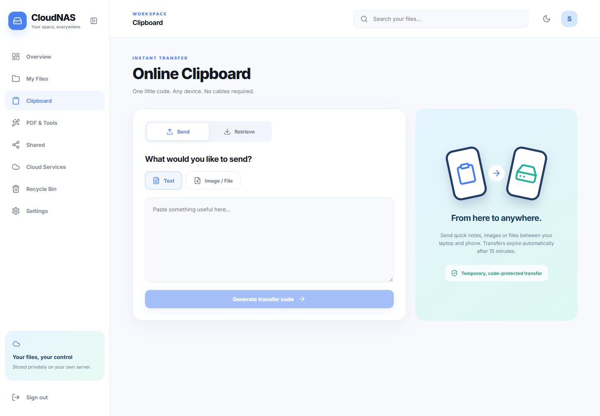
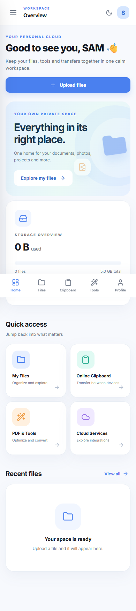
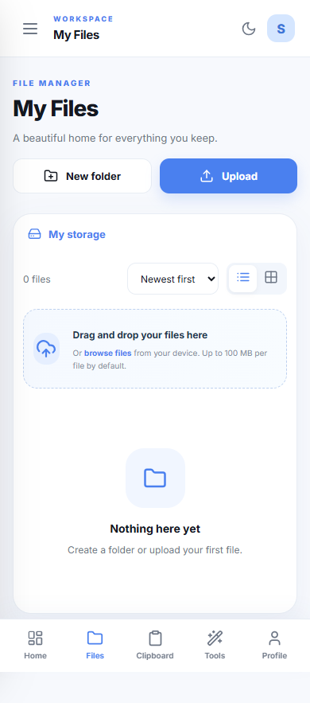
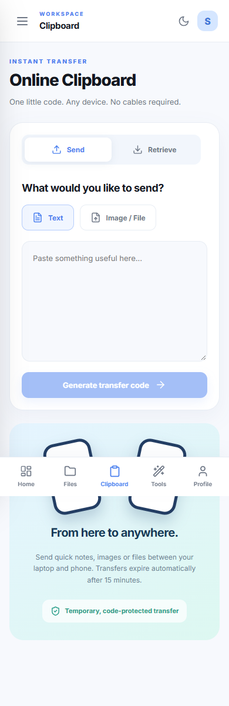

# CloudNAS — Your private cloud storage

CloudNAS is a responsive, self-hosted file storage and transfer application built with React, Vite, Express and MongoDB. It brings private file management, folders, sharing, temporary cross-device transfers and document utilities into one workspace.

## Features
- Account registration and login with Argon2 password hashing, protected sessions and per-user file isolation.
- Private file upload/download, folders, search, sorting, grid/list views, rename, move and recycle-bin recovery.
- Time-limited file sharing, recipient-restricted shares and link revocation.
- Temporary text/file transfers using six-digit codes.
- PNG/JPG/TXT to PDF conversion and optional PDF optimization when Ghostscript is installed.
- Responsive desktop sidebar and mobile bottom navigation, light/dark themes.
- Cloud integration status page with honest connection states; third-party providers require configuration.

## Technology
- Frontend: React 18, Vite, React Router, Axios and Lucide icons.
- Backend: Node.js 22+, Express, Mongoose, MongoDB, Argon2 and PDF-Lib.
- Optional deployment: Docker Compose with persistent MongoDB and file-storage volumes.

## Local setup (Windows / VS Code)
1. Install Node.js 22+, MongoDB Community Server and Git.
2. Copy .env.example to .env; set a unique random JWT_SECRET of at least 32 characters and confirm MONGO_URI.
3. Start MongoDB and make sure the configured database is reachable.
4. From the project root run:
   npm install
   npm run dev
5. Open http://localhost:5173, create an account and start uploading files.
6. Optional PDF optimization requires Ghostscript (gswin64c) installed and available on PATH.

## Docker Compose
Create .env with a strong JWT_SECRET and suitable CORS_ORIGIN, then run docker compose up --build.
Open http://localhost:4000. Docker Compose persists MongoDB data and uploaded files in named volumes. Use HTTPS through a reverse proxy before exposing the service outside a trusted network.

## Quality checks
Run npm run build, npm test and npm audit --omit=dev.
The browser screenshots in screenshots/ document the desktop and mobile layouts. The QA scripts in qa/ capture repeatable browser checks.

## Important deployment notes
- Cloud Drive, OneDrive, Dropbox, WebDAV, FTP and SFTP are integration placeholders until provider credentials and OAuth/protocol flows are configured.
- PDF optimization depends on Ghostscript; it is not bundled.
- This is a functional self-hosted starter, not a certified security product. Before public production use, add malware scanning, backups and restore drills, monitoring, rate-limit review and an independent security assessment.
- Do not commit .env, private uploads or database files. Keep the storage directory and database protected.
## Screenshots

### Desktop

### Mobile

